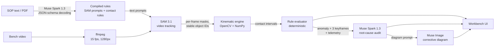

# KineSight

**Sensorless visual telemetry and SOP compliance for assembly lines.** KineSight turns an ordinary overhead camera into a QA station. SAM 3.1 tracks every tool and part. A deterministic OpenCV/NumPy engine measures each contact to the frame. Muse Spark 1.3 audits only the moments where the math says a step went wrong, and Muse Image draws the fix.

Built for the Meta Global AI Developer Hackathon (Push the Frontier: Manufacturing, Hardware Assembly & Physical Systems).

**Live demo: [kinesight.onrender.com](https://kinesight.onrender.com/?preset=plate_4screw_defect&run=1)**
- It replays the three recorded preset analyses instantly, including the downloadable QA report and the side-by-side cycle comparison.
- It also accepts your own clips: up to 60 s each, within a small daily budget. On the free server a 10 s clip takes about 3 minutes and a full minute about 15, so keep the tab open while it runs.
- The first visit after a quiet spell can take about a minute while the server wakes up.

**Demo video:** *(YouTube link)*


## Contents

1. [What KineSight does](#what-kinesight-does)
2. [The problem](#the-problem)
3. [How each Meta model gets us there](#how-each-meta-model-gets-us-there)
4. [How it works](#how-it-works)
5. [Demo presets](#demo-presets)
6. [User manual](#user-manual)
7. [Running it yourself](#running-it-yourself)
8. [API reference](#api-reference)
9. [Repository layout](#repository-layout)
10. [Limitations and next steps](#limitations-and-next-steps)
11. [Credits](#credits)

## What KineSight does

You give KineSight two things:
- a **written procedure** (an SOP, as text or PDF);
- a **video of one work cycle** at a bench.

It answers four questions:
1. **Which steps did the operator do, how many times, and for how long?** The answer is measured from pixel masks, frame by frame.
2. **Does that meet the SOP?** Each step gets PASS or a specific failure: skipped, too few contacts, too short, or out of order. The cycle gets a compliance score.
3. **If not, is it a real defect, and why did it happen?** The answer is a root cause and a corrective action in plain words, checked against the actual keyframes.
4. **What should the operator do differently?** The answer is a generated work-instruction diagram.
5. **How does this cycle compare with a good one?** It is shown side by side with a compliant reference cycle, on one time axis.

Every analysis can be downloaded as a self-contained QA report (HTML, printable to PDF) for the line supervisor.

The outcome is zero-sensor quality assurance for manual assembly. It works with any camera, needs no training data and no instrumentation per station, and takes a few minutes to set up a new procedure.

## The problem

Catching a skipped screw, a rushed solder joint or an out-of-order step normally means instrumenting every bench with smart torque drivers, RFID gates and PLC light curtains, at $10k–$25k per station. Garment and electronics lines in Bangladesh and other emerging markets can't justify that, so defects get caught at final test or in the field, where they cost far more.

Pointing a vision-language model at raw video doesn't fix this either. VLMs sample sparse frames and guess at actions. They can't tell a 0.4 s iron contact (a cold joint) from the 2.0 s the spec requires, and they can't reliably count four screw-downs across 400 frames. A QA system has to *measure*, and it has to be right about timing and counts every time.

## How each Meta model gets us there

**The goal:** verify every step of a manual procedure from one ordinary camera, with no sensors and no per-station training, and explain each failure so the line can fix it.

No single model can do that. KineSight gives each Meta model the part of the job it is best at, and keeps counting and timing in deterministic code.

### SAM 3.1: the measuring instrument

**What it does here.** SAM 3.1 finds and follows each tool, part and hand named in the rules, through the whole video, from a text prompt such as `"screwdriver"`, `"metal plate"` or `"soldering iron"`. For every frame it returns a box and a pixel mask for each object, with an object ID that stays the same from frame to frame.

**Why it's essential.**
- **No training per station.** A new procedure only needs new nouns. Classic vision would need a labeled dataset and a trained detector for every tool on every line, which is exactly the cost that keeps small factories from automating QA.
- **Pixel masks, not just boxes.** Masks are what make geometry possible: centroids, speeds and the dilated-mask contact test that tells *touching* from *near*.
- **IDs that stay stable through occlusion.** The operator's hand covers the part exactly where the work happens. Stable tracks keep one screw-down from being counted as two.

**How we call it.**
1. The clip is resampled to 15 fps and uploaded once through the Files API.
2. Each concept prompt is segmented with one streamed `POST /v1/responses` call.
3. The mask stream is decoded with Meta's official `@meta-sam/parser`, in a small Node sidecar that writes bit-packed masks for NumPy.
4. Raw output is cached per `(video, prompt)`, so editing rules never re-bills SAM.

**Cost.** At $0.20 per 1,000 video frames, a 40-second cycle with three tracked objects costs about $0.36 to segment. That makes inspecting every unit economically realistic.

### Muse Spark 1.3: the engineer and the auditor

Muse Spark plays two roles. Both need language and judgment, which math can't supply.

**1. SOP compiler: language in, checkable rules out.** An SOP is written for people: "drive all four corner screws until seated, keep the driver engaged for at least 1.5 seconds". Muse Spark turns it, using strict JSON-schema structured output, into:
- the SAM prompts to track, named by appearance (for example "metal plate", not "mounting plate", because SAM finds what things *look* like);
- one rule per verifiable step: actor, target, minimum seconds per contact, and number of contacts.

PDF SOPs work too. Structured output means the response always parses into the rules the engine needs. Without this step, someone would have to hand-write rules for every procedure.

**2. Root-cause auditor: judgment only where the math flags a problem.** When a rule fails, Muse Spark gets:
- three keyframes from before, at and after the anomaly, with SAM contours drawn on;
- the measured telemetry;
- the failing rule.

It decides whether this is a **genuine defect** or a **measurement artifact** such as occlusion or a mask dropout. It names *where* it happened (for example "the top-right corner hole") and *why*, and writes a corrective action for the line supervisor.

It is told that the telemetry is ground truth for *when* and *how many*, so it never re-estimates durations from pixels. It is only called on anomalies, so a passing cycle costs no language-model calls at all.

### Muse Image 1.0: closing the loop on the floor

A root cause in a dashboard doesn't change what the operator does next cycle. For each confirmed defect, Muse Spark writes a diagram prompt and Muse Image draws a top-down work-instruction diagram of the corrected procedure. The diagram shows numbered positions, the required sequence and hold times. A picture works across the many languages spoken on a factory floor, and it can be printed and posted at the station.

### The Meta Model API: one key, one integration

All three models are reached through the OpenAI-compatible Meta Model API (`https://api.meta.ai/v1`) with a single key:
- the Files API for video;
- streaming Responses for SAM;
- structured outputs for Muse Spark;
- image generation for Muse Image.

One client, one retry policy (exponential backoff with `tenacity`) and one place to budget spend.

| Model | Pipeline stage | Input | Output | Why it matters |
|---|---|---|---|---|
| `sam-3.1` | Tracking | Video and text prompts | Per-frame masks with stable IDs | Turns a $30 camera into a measuring instrument with no training |
| `muse-spark-1.3` | SOP compiler | SOP text or PDF | JSON rules and SAM prompts | Any written procedure becomes machine-checkable in seconds |
| `muse-spark-1.3` | Auditor | 3 keyframes, telemetry, rule | Genuine or artifact, location, root cause, fix | Separates real defects from occlusion and explains them |
| `muse-image-1.0` | Corrective diagram | Diagram prompt | Work-instruction image | Gives the operator a visual fix |

## How it works



1. **SOP compiler (Muse Spark 1.3).** The SOP becomes SAM prompts plus one contact rule per step. The rules are a proposal: an engineer can tune or remove any of them in the UI before analysis.
2. **Tracking (SAM 3.1).**
   - The video is resampled to 15 fps and 1280 px wide, then segmented once per prompt.
   - `hand` is always tracked as context.
   - SAM's output streams straight to disk. The decoded masks stay bit-packed in a memory-mapped file and are unpacked one frame at a time. Together these keep a minute-long clip of a frame-filling part to about 250 MB in total.
3. **Kinematic engine (`backend/services/kinematics.py`).** No model is involved in this stage. For every frame and object it computes:
   - **Centroid** from spatial moments: `(x, y) = (M10/M00, M01/M00)`.
   - **Tool speed** in frame diagonals per second, rolling-median smoothed over 0.6 s. Speed separates transit from stationary work and doesn't depend on resolution.
   - **Contact** as `sum(Dilate(Mask_tool, k) AND Solid(Mask_target))`. The target is taken as the union of per-instance convex hulls: the operator's hand cuts a notch into the plate mask exactly where the work happens, and the hull fills it back in.
   - **Intervals.** A frame counts as contact when the overlap clears the threshold *and* the tool is below the work-speed threshold. Gaps under 0.8 s (brief occlusions) are bridged and blips under 0.6 s are dropped. The result is discrete `start_sec / end_sec / duration_sec` intervals, each with where on the frame the contact happened.
4. **Rule evaluator (`rule_evaluator.py`).**
   - Rules are matched in SOP order, so one contact is never credited to two steps.
   - Each step gets `PASS`, `FAIL_MISSING`, `FAIL_COUNT_SHORTFALL`, `FAIL_SHORT_DURATION` or `FAIL_ORDER`.
   - The compliance score is the mean step credit. A passed step earns 1. A count or duration shortfall earns the share of required contacts that qualified, so 3 of 4 screws earns 0.75. An out-of-order step earns 0.
5. **Audit (Muse Spark 1.3 + Muse Image).** Only flagged steps are audited, as described above.
   - The cycle is **FAIL** if any defect is confirmed (or the auditor is unreachable).
   - It is **REVIEW** if every flag was judged an artifact.
   - It is **PASS** if nothing was flagged.

### Engineering guarantees

- **Math before language models.** Durations, counts and contacts come only from `kinematics.py`. The auditor judges only *where* and *why*.
- **Idempotent caching.** Results are keyed by `(video sha256, SOP sha256, analysis settings)` and raw SAM output by `(video, prompt)`. Re-running a known clip returns in milliseconds, and editing an SOP never re-bills SAM.
- **Graceful degradation.** Every Meta API call retries with exponential backoff. If the auditor is unreachable, the deterministic finding still stands and the UI says so.
- **Bounded spend on public hosts.** Daily budgets cover new video analyses, rule re-runs and compiles. Clip length and size are capped. A server without a key replays recorded results and never calls the API.
- **Bounded memory.** Memory stays flat as clips get longer. A 59 s upload was tested in a container with Render's free-plan limits (512 MB, no swap): it peaked at about 250 MB and never hit the limit.
- **Resolution-independent overlay.** Mask polygons are normalized to `[0, 1]`, so the overlay lines up at any player size.

## Demo presets

| Preset | Footage | Result |
|---|---|---|
| Mounting plate: operator skips a screw | Pexels 856232, reversed and trimmed at 27 s | **FAIL**, 3 of 4 screw contacts (75% compliance). Muse Spark confirms the top-right hole is empty |
| Mounting plate: compliant cycle | Pexels 856232, reversed | **PASS**, 4 of 4 |
| Soldering bench: flux dip + joint dwell | Pexels 7314032 | **PASS**, flux 3.4 s, joint 14.9 s |

All three SOPs were compiled live by Muse Spark 1.3. Their results ship pre-computed in `backend/presets/*/cache`, so the presets replay instantly, even without an API key.

## User manual

### The workbench at a glance

| Area | What it holds |
|---|---|
| **Left: rules** | Footage picker (presets and upload), the SOP editor, **Compile rules with Muse Spark 1.3**, the compiled rule cards, and **Analyze video** |
| **Center: evidence** | The video with live SAM 3.1 mask overlays, and the kinematic telemetry timeline below it |
| **Right: verdict** | QA verdict, compliance score, **Download QA report** and **Compare cycles**, per-step results, defect cards with root cause, keyframes, the Muse Image diagram, and pipeline latency |

The layout adapts to the screen:
- **Wider than 1280 px:** three columns side by side.
- **Tablets and small laptops:** the rules column stays pinned at the left while the results scroll.
- **Phones:** one column, and **Analyze video** floats at the bottom of the screen. After an analysis, the page scrolls to the results.

**Analyze video** is always within reach at every size.

### Step 1: choose footage

- **Presets.** Click one of the three cards. Its video, SOP and compiled rules load together.
- **Your own clip.** Click **Analyze your own video** (highlighted, with a LIVE badge) and pick a file.
  - On the hosted demo, clips are limited to 60 s and 100 MB. The note under the button shows how many live analyses are left today.
  - Running it yourself, the only limits are the ones you set (see [Configuration](#configuration)).

### Step 2: give it the SOP

Paste or type the procedure into **Standard operating procedure**, or click **PDF / TXT** to upload a document. An uploaded document is compiled straight away.

### Step 3: compile the rules

Click **Compile rules with Muse Spark 1.3**. A new SOP takes roughly 20–60 s. An SOP that was compiled before comes back instantly from the cache, and the note under the button says which happened. You get:
- **SAM chips**: the objects SAM 3.1 will track, color-coded to match the video overlay.
- **Rule cards**, one per verifiable step. Each card shows the description, `actor ∩ target`, the minimum seconds per contact (`≥ 1.5 s`) and the number of contacts (`× 4`).

### Step 4: review and tune the rules

The compiled rules are a proposal. Before analyzing you can:
- change **≥ s**, the minimum duration of each contact;
- change **×**, the number of contacts the step needs;
- remove a rule with the **✕** that appears when you hover over the card.

Edited rules reuse the cached SAM output. Only the kinematics, the rule check and, if something fails, the audit run again. The note under the compile button changes to "Rules edited by reviewer".

On the hosted demo the presets' SAM output isn't stored, so re-running a preset with edited rules needs a fresh SAM pass and takes about as long as uploading the clip.

### Step 5: analyze

Click **Analyze video**. The line under the button shows progress:
- Preparing video
- Segmenting N objects with SAM 3.1, then "SAM 3.1 finished '…'" for each object
- Computing centroids, velocities and contacts
- Auditing flagged steps with Muse Spark
- Done

A combination of video and rules that was analyzed before is **Served from cache** instantly. On the hosted demo a 10 s clip takes about 3 minutes and a 60 s clip about 15, because the free server has a tenth of a CPU core. Keep the tab open while it runs: the free server sleeps after 15 minutes without visitors.

### Step 6: read the results

**Video and overlays (center top)**
- Each tracked object is drawn as a colored mask outline with its centroid and label. The colors match the SAM chips.
- **Play / pause** and **restart** sit under the video, next to the time, the frame counter and the analysis frame rate.
- Click an object's chip (for example `screwdriver`) to hide or show its overlay.

**Kinematic telemetry (center bottom)**
- The line chart is the tool's speed over time, in frame diagonals per second.
  - The **dashed line** is the stationary-work threshold: contact only counts while the tool is below it.
  - The **white line** marks the current video time.
  - A **red line** marks a defect.
- Under the chart, each step has a lane:
  - **green bars** are contacts that met the minimum duration;
  - **amber bars** are contacts that were too short;
  - a **glowing red marker** sits where a defect was flagged.
- The lane header reads like `3/4 contacts ≥ 1.5s`.
- **Click anywhere** on the chart or a lane to jump the video there.

**Verdict (right)**
- **QA verdict and compliance:** PASS, FAIL or REVIEW, the score, the cycle time and the frames analyzed.
- **SOP steps:** each step's status, plus a chip for every measured contact, such as `#2 11.5s · 5.6s` (start · duration). Click a chip to jump to it. Missing contacts show as dashed red `#4 missing` chips.
- **Defect cards**, one per flagged step:
  - **Severity**: CRITICAL for a skipped step or too few contacts, MAJOR for too short or out of order.
  - **`t = …s ↗`** jumps to the moment of the defect.
  - **The auditor's call**, with its confidence: "Muse Spark 1.3 confirmed a genuine defect", "judged this a measurement artifact", or "Auditor unavailable · deterministic finding only".
  - **Root cause** and **Corrective action**.
  - **Audited keyframes**: click to zoom.
  - **Muse Image corrective diagram**: click to zoom.
- **Pipeline latency:** time spent in each stage of the original run, and whether this view was served from cache.

### Step 7: share the report and compare cycles

**Download QA report** saves one self-contained HTML file. It contains:
- the verdict and compliance score;
- a contact timeline for every step;
- the steps table with every measured contact;
- each defect, with its root cause, corrective action, audited keyframes and the Muse Image diagram.

The file opens offline in any browser, and its **Print / save as PDF** button produces a PDF to hand to the line supervisor.

**Compare cycles** appears when another preset checks the same tool and part pairs, for example the two mounting-plate cycles.
- It runs the reference cycle under *this* cycle's rules, so both are judged the same way. A cached reference opens instantly.
- The two cycles are shown side by side:
  - the masked videos, with **Play both from start**;
  - each step's contact lanes on one shared time axis. A hatched area means that cycle had already ended.
  - a table of qualifying contacts, total contact time, cycle time and compliance, with this cycle's shortfalls in red.
- When more than one reference fits, pick it from the dropdown.

### Verdicts and statuses

| Status | Meaning | Step credit |
|---|---|---|
| `PASS` | Enough qualifying contacts, in order | 1 |
| `FAIL_MISSING` | No contact at all: the step was skipped | 0 |
| `FAIL_COUNT_SHORTFALL` | Fewer contacts than the step requires | qualifying ÷ required |
| `FAIL_SHORT_DURATION` | Enough contacts, but too few lasted the minimum time | qualifying ÷ required |
| `FAIL_ORDER` | The step was otherwise complete, but its first contact came before the previous step's | 0 |

The cycle is **PASS** when nothing is flagged, **FAIL** when a flagged step is confirmed (or can't be audited), and **REVIEW** when every flag was judged a measurement artifact, meaning a person should take a look.

### Writing an SOP that compiles well

- **One physical action per step**, with the tool and the part it touches: "Using the screwdriver, drive all four corner screws."
- **State numbers when you have them:** "at least 1.5 seconds per screw", "four screws". Otherwise Muse Spark picks a realistic value, such as 1.5 s for a screw or 2.0 s for a solder joint.
- **Describe tools by what they look like** ("Phillips screwdriver with an orange handle"). The compiler turns them into prompts SAM can find.
- **Purely manual steps can't be checked from video and are skipped:** placing a screw by hand, a visual inspection, peeling a film. Hands rest on the work the whole time, so their contacts can't be counted.

See `backend/presets/plate_4screw_sop.txt` and `solder_joint_sop.txt` for examples.

### Filming a clip that analyzes well

- **A fixed camera** above or at an angle to the bench. A moving camera breaks speed measurements.
- **Keep the whole work area in frame for the whole cycle:** the part, the tools and where they rest.
- **Even light without hard glare.** Shiny metal parts track better under diffuse light.
- **One cycle per clip.** Trim idle time before and after; it's analyzed and billed too.
- Any common format works (`mp4`, `mov`, `m4v`, `avi`, `mkv`, `webm`). Clips are converted to 15 fps and 1280 px wide automatically.

### Shortcuts in the URL

| Parameter | Effect |
|---|---|
| `?preset=plate_4screw_defect` | Opens a preset (`plate_4screw_pass`, `solder_joint_pass`) |
| `&run=1` | Analyzes it on load |
| `&t=24.2` | Jumps the video to 24.2 s once results arrive |

### Troubleshooting

| You see | What it means | What to do |
|---|---|---|
| "Backend unreachable" | The UI can't reach the API | Start the backend (`uvicorn main:app --port 8000`) |
| "This server replays recorded analyses" | The server has no `META_API_KEY` | Presets still replay. Add a key to analyze new clips or edited rules |
| "… budget for today is used up" | The public daily budget is spent | Try again tomorrow, or run it yourself |
| "Video is 75s long; the public demo accepts up to 60s" | The clip is over the cap | Trim it to one cycle |
| "These rules need a fresh SAM 3.1 pass over this preset's clip" | Edited rules on a preset longer than the server's clip cap | Analyze the preset's original rules, upload a shorter clip, or run it yourself |
| An upload stopped with an error partway through | The free server restarted, for example after sleeping | Upload it again, and keep the tab open until it finishes |
| A rule finds no contacts at all | SAM didn't find one of the objects | Rename it to what it looks like ("metal plate", not "bracket") and recompile |
| The first page load takes a minute | The free server was asleep | Wait. The next loads are instant |

## Running it yourself

### Locally

Requirements: Python 3.11+, Node 20+, ffmpeg on `PATH`, and a Meta Model API key.

```bash
# 1. API key
echo "META_API_KEY=your-key" > .env

# 2. Backend
cd backend
python -m venv .venv
.venv/Scripts/activate            # macOS/Linux: source .venv/bin/activate
pip install -r requirements.txt
(cd sam_decoder && npm install)   # Meta's SAM mask decoder
uvicorn main:app --port 8000

# 3. Frontend (second terminal)
cd frontend
npm install
npm run dev                       # http://localhost:3000
```

Open `http://localhost:3000`, pick a preset and press **Analyze video**.

```bash
cd backend && python -m pytest -q          # 24 unit tests: kinematics, rules, schemas
python scripts/build_presets.py            # rebuild presets from Pexels and re-run the pipeline
```

### Docker (single container)

```bash
docker build -t kinesight .
docker run -p 7860:7860 -e META_API_KEY=your-key kinesight    # http://localhost:7860
```

The image serves the static frontend and the API on one port, with the public-deployment guards on by default (see below).

### Deploying on Render's free plan

The repo includes a `render.yaml` Blueprint.
1. In Render, choose **New → Blueprint** and pick this repository. It creates a free Docker web service.
2. In the service's **Environment** tab, set `META_API_KEY`. Uploads and live analysis switch on after the automatic redeploy.
3. Without a key, the site replays the recorded presets and never calls the API.

The free plan has 512 MB of RAM and 0.1 CPU. The Blueprint therefore:
- limits clips to 60 s and 100 MB;
- runs one job at a time;
- decodes masks one prompt at a time;
- encodes video on one thread;
- limits Python's memory arenas;
- analyzes uploads at 640 px wide (`UPLOAD_WIDTH`) and encodes them once. The preset results stay at 1280 px. On the skipped-screw clip, 640 px finds the same three contacts and the same 75% FAIL, and the measurement step runs 20× faster.

Masks are memory-mapped and decoded one frame at a time, and SAM's output streams to disk, so memory stays flat as clips get longer (see [Engineering guarantees](#engineering-guarantees)).

### Configuration

Every value can be set in `.env` or as an environment variable.

| Variable | Default (local / Docker) | Purpose |
|---|---|---|
| `META_API_KEY` | none | Meta Model API key. Without it the server is replay-only |
| `LIVE_ANALYSIS` | `1` | `0` forces replay-only mode even with a key |
| `DAILY_VIDEO_JOBS` | `0` / `10` | New video analyses per day (`0` = unlimited) |
| `DAILY_RULE_JOBS` | `0` / `40` | Re-runs with edited rules per day |
| `DAILY_COMPILES` | `0` / `40` | SOP compiles not already cached, per day |
| `MAX_VIDEO_SEC` | `0` / `60` | Longest accepted clip, in seconds |
| `MAX_UPLOAD_MB` | `0` / `200` | Largest accepted upload |
| `MAX_CONCURRENT_JOBS` | `2` | Analyses running at once |
| `SAM_DECODE_WORKERS` | `4` | Mask decoders running at once (use `1` on 512 MB hosts) |
| `FFMPEG_THREADS` | `0` (ffmpeg decides) | Video encoding threads; each one buffers frames (use `1` on 512 MB hosts) |
| `FPS_RATE`, `ANALYSIS_WIDTH` | `15`, `1280` | Analysis frame rate and width |
| `UPLOAD_WIDTH` | `1280` / `640` | Analysis width for uploaded clips; the presets keep `ANALYSIS_WIDTH` |
| `STATIONARY_SPEED` | `0.45` | Work-speed threshold, in frame diagonals per second |
| `DILATE_FRAC`, `OVERLAP_FRAC` | `0.03`, `0.0002` | Contact dilation kernel and minimum overlap, relative to the frame |
| `MAX_GAP_SEC`, `MIN_INTERVAL_SEC` | `0.8`, `0.6` | Occlusion gaps bridged, and shortest contact kept |
| `SAM_MODEL`, `SPARK_MODEL`, `IMAGE_MODEL` | `sam-3.1`, `muse-spark-1.3`, `muse-image-1.0` | Model IDs |

## API reference

| Method and path | Purpose |
|---|---|
| `GET /api/health` | Status, whether a key is set, and the remaining daily budgets |
| `GET /api/presets` | Preset clips with their SOP text and compiled rules |
| `POST /api/sop/compile` | `{"text": "..."}` → `{"sop": CompiledSop, "cached": bool}` |
| `POST /api/sop/compile-file` | Multipart `file` (PDF/TXT) → `{"text", "sop", "cached"}` |
| `POST /api/jobs` | Multipart `sop` (CompiledSop JSON) plus `preset_id` or `video` → `{"job_id"}` |
| `GET /api/jobs/{job_id}` | `{"status", "stage", "error", "result": JobResult}` |
| `GET /presets/…`, `/cache/…` | Videos, per-frame tracks, keyframes and diagrams |

The contracts (`CompiledSop`, `Telemetry`, `AuditVerdict`, `JobResult`) are Pydantic models in `backend/schemas.py`.

## Repository layout

```
backend/
  main.py                 FastAPI: presets, SOP compile, analysis jobs, budgets, static media
  config.py               model IDs, kinematic thresholds, deployment guards
  schemas.py              Pydantic contracts: CompiledSop, Telemetry, AuditVerdict, JobResult
  database.py             SQLite job records and daily usage budgets
  services/
    meta_client.py        Meta Model API client: structured outputs, images, retries
    sop_compiler.py       Muse Spark 1.3: SOP text/PDF -> rules
    sam_tracker.py        SAM 3.1 upload, streaming segmentation, lazy mask decoding
    kinematics.py         centroids, speed, dilated-mask contact, intervals
    rule_evaluator.py     deterministic step verdicts, anomalies and partial-credit score
    auditor.py            keyframes, Muse Spark audit, Muse Image diagram
    pipeline.py           orchestration and result cache
  sam_decoder/decode.mjs  @meta-sam/parser -> bit-packed masks for NumPy
  presets/                demo clips, SOPs and cached results
  scripts/                preset builder, Hugging Face Space deploy
  tests/                  kinematics, rule engine and schema tests
frontend/src/
  app/page.tsx            responsive workbench
  components/             SopEditorPanel, AnnotatedVideoCanvas, TelemetryTimeline, AuditVerdictPanel, CompareCycles
  lib/report.ts           self-contained HTML QA report with embedded keyframes and diagram
  lib/api.ts              API client and job polling
Dockerfile                single-container build (static frontend served by FastAPI)
render.yaml               Render Blueprint for the hosted demo
```

## Limitations and next steps

- **Contact rules only.** KineSight verifies *that* and *how long* a tool touched a part, and in what order. It can't measure torque or confirm that a screw is fully seated. Pairing it with one cheap sensor per station would close that gap.
- **One camera.** Work hidden from the camera can't be measured. The auditor flags those cases as artifacts instead of defects.
- **Latency.** Muse Spark calls take 20–60 s, which is fine for a post-cycle audit but not for an in-cycle alert. Streaming SAM over a live camera feed is the next step.
- **Video leaves the building.** Many factories can't send line video to a cloud API. An on-prem or VPC deployment of SAM 3.1 would remove that blocker.

## Credits

Demo footage from [Pexels](https://www.pexels.com) under the Pexels License: [856232](https://www.pexels.com/video/unscrewing-screws-856232/) and [7314032](https://www.pexels.com/video/a-person-using-soldering-iron-7314032/). The plate clips are edited: reversed so removal plays as fastening, and the defect cut is trimmed.
