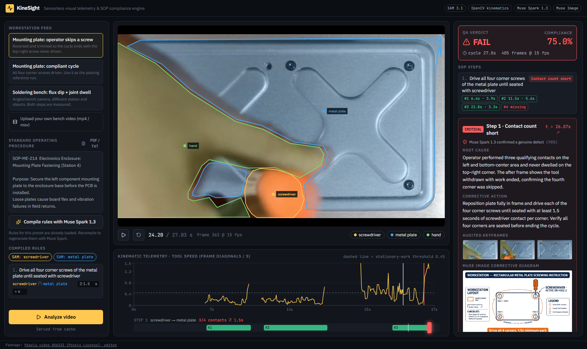
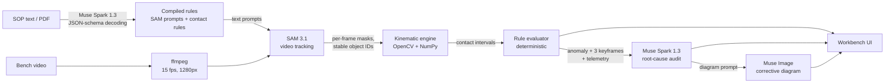

# KineSight

**Sensorless visual telemetry and SOP compliance for assembly lines.** KineSight turns an ordinary overhead camera into a QA station. SAM 3.1 tracks every tool and part. A deterministic OpenCV/NumPy engine measures each contact to the frame. Muse Spark 1.3 audits only the moments where the math says a step went wrong.

Built for the Meta Global AI Developer Hackathon (Push the Frontier: Manufacturing, Hardware Assembly & Physical Systems).



## The problem

Catching a skipped screw, a rushed solder joint or an out-of-order step normally means instrumenting every bench with smart torque drivers, RFID gates and PLC light curtains, at $10k–$25k per station. Garment and electronics lines in Bangladesh and other emerging markets can't justify that, so defects get caught at final test or in the field.

Pointing a vision-language model at raw video doesn't fix this either. VLMs sample sparse frames and guess at actions. They can't tell a 0.4 s iron contact (a cold joint) from the 2.0 s the spec requires, and they can't reliably count four screw-downs across 400 frames.

## How it works



1. **SOP compiler (Muse Spark 1.3).** The SOP is compiled with strict JSON-schema decoding into the objects SAM should segment (short visual noun phrases) and one machine-checkable rule per step: which actor must touch which target, the minimum seconds per contact, and how many contacts. The rules are a proposal. In the UI an engineer can tune or remove any of them before analysis.
2. **Tracking (SAM 3.1).** The video is resampled to 15 fps, uploaded once through the Files API, and segmented once per concept prompt over `POST /v1/responses`. SAM returns a box and mask for every object in every frame, with IDs that stay stable across frames. Mask streams are decoded with Meta's official `@meta-sam/parser`.
3. **Kinematic engine (`backend/services/kinematics.py`).** No model is involved in this stage. For every frame and object it computes:
   - **Centroid** from spatial moments: `(x, y) = (M10/M00, M01/M00)`.
   - **Tool speed** in frame diagonals per second, rolling-median smoothed over 0.6 s. It separates transit from stationary work and doesn't depend on resolution.
   - **Contact** as `sum(Dilate(Mask_tool, k) AND Solid(Mask_target))`. The target is taken as the union of per-instance convex hulls, because the operator's hand cuts a notch into the plate mask exactly where the work happens, and the hull restores it.
   - **Intervals**: a frame counts as contact when the overlap clears the threshold and the tool is below the work-speed threshold. Gaps under 0.8 s (brief occlusions) are bridged and blips under 0.6 s are dropped, giving discrete `start_sec / end_sec / duration_sec` intervals, each with where on the frame the contact happened.
4. **Rule evaluator (`rule_evaluator.py`).** It flags `FAIL_MISSING`, `FAIL_COUNT_SHORTFALL`, `FAIL_SHORT_DURATION` and `FAIL_ORDER`, and computes the compliance score as the mean step credit. A passed step earns 1. A count or duration shortfall earns the share of required contacts that qualified, so 3 of 4 screws earns 0.75. An out-of-order step earns 0.
5. **Audit (Muse Spark 1.3 + Muse Image).** Only for flagged steps: three keyframes around the anomaly, with SAM contours drawn on, go to Muse Spark along with the telemetry and the SOP rule. It decides whether this is a genuine defect or an occlusion artifact, names where it happened, and writes the corrective action plus a prompt for Muse Image, which draws the work-instruction diagram.

### Engineering guarantees

- **Math before language models.** Durations, counts and contacts come only from `kinematics.py`. The auditor is told the telemetry is ground truth for *when* and *how many*. It judges only *where* and *why*.
- **Idempotent caching.** Results are keyed by `(video_sha256, sop_sha256, analysis settings)`, and raw SAM output is cached per `(video, prompt)`, so re-running a known clip returns in milliseconds and editing an SOP never re-bills SAM.
- **Graceful degradation.** Every Meta API call retries with exponential backoff (`tenacity`). If the auditor is unreachable, the deterministic finding still stands and the UI says so.
- **Resolution-independent overlay.** Mask polygons are normalized to `[0, 1]`, so the canvas overlay lines up at any player size.

## Demo presets

| Preset | Footage | Result |
|---|---|---|
| Mounting plate: operator skips a screw | Pexels 856232, reversed and trimmed at 27 s | **FAIL**, 3 of 4 screw contacts (75% compliance). Muse Spark confirms the top-right hole is empty |
| Mounting plate: compliant cycle | Pexels 856232, reversed | **PASS**, 4 of 4 |
| Soldering bench: flux dip + joint dwell | Pexels 7314032 | **PASS**, flux 3.4 s, joint 14.9 s |

All three SOPs in the repo were compiled live by Muse Spark 1.3. Their results ship pre-computed in `backend/presets/*/cache`, so the demo replays instantly without an API key.

## Running it

Requirements: Python 3.11+, Node 20+, ffmpeg on `PATH`, and a Meta Model API key.

```bash
# 1. API key
echo "META_API_KEY=your-key" > .env

# 2. Backend
cd backend
python -m venv .venv
.venv/Scripts/activate            # macOS/Linux: source .venv/bin/activate
pip install -r requirements.txt
(cd sam_decoder && npm install)   # Meta's SAM mask decoder
uvicorn main:app --port 8000

# 3. Frontend (second terminal)
cd frontend
npm install
npm run dev                       # http://localhost:3000
```

Open `http://localhost:3000`, pick a preset and press **Analyze video**. `?preset=plate_4screw_defect&run=1` runs a preset on load. To try your own footage, upload a bench video, paste or upload the SOP, compile it, check the rules, and analyze.

```bash
cd backend && python -m pytest -q          # 24 unit tests: kinematics, rules, schemas
python scripts/build_presets.py            # rebuild presets from Pexels and re-run the pipeline
```

Thresholds live in `backend/config.py` and can be overridden from `.env` (`STATIONARY_SPEED`, `DILATE_FRAC`, `MAX_GAP_SEC`, …).

### Docker (single container)

```bash
docker build -t kinesight .
docker run -p 7860:7860 -e META_API_KEY=your-key kinesight    # http://localhost:7860
```

The image serves the static frontend and the API on one port. Guards for a public deployment are on by default: daily budgets for new video analyses, preset re-runs with edited rules, and SOP compiles, plus 60 s / 200 MB upload caps (`DAILY_VIDEO_JOBS`, `DAILY_RULE_JOBS`, `DAILY_COMPILES`, `MAX_VIDEO_SEC`, `MAX_UPLOAD_MB`; `0` = unlimited). `LIVE_ANALYSIS=0` turns the server into a replay of the cached preset analyses that never calls the Meta API; `render.yaml` deploys that mode on Render's free plan. `python scripts/deploy_space.py` publishes the committed tree to a Hugging Face Docker Space and stores the key as a Space secret.

## Repository layout

```
backend/
  main.py                 FastAPI: presets, SOP compile, analysis jobs, static media
  config.py               model IDs and kinematic thresholds
  schemas.py              Pydantic contracts: CompiledSop, Telemetry, AuditVerdict
  database.py             SQLite job records and daily usage budgets
  services/
    sop_compiler.py       Muse Spark 1.3: SOP text/PDF -> rules
    sam_tracker.py        SAM 3.1 upload, streaming segmentation, mask decoding
    kinematics.py         centroids, speed, dilated-mask contact, intervals
    rule_evaluator.py     deterministic step verdicts and anomalies
    auditor.py            keyframes, Muse Spark audit, Muse Image diagram
    pipeline.py           orchestration and result cache
  sam_decoder/decode.mjs  @meta-sam/parser -> bit-packed masks for NumPy
  presets/                demo clips, SOPs and cached results
  scripts/                preset builder, Hugging Face Space deploy
  tests/
frontend/src/
  app/page.tsx            three-panel workbench
  components/             SopEditorPanel, AnnotatedVideoCanvas, TelemetryTimeline, AuditVerdictPanel
Dockerfile                single-container build (static frontend served by FastAPI)
render.yaml               Render Blueprint for the hosted replay demo
```

## Meta models used

| Model | Role |
|---|---|
| `sam-3.1` | Text-prompted video segmentation and tracking of tools, parts and hands |
| `muse-spark-1.3` | SOP → rules compiler (JSON schema), multimodal keyframe auditor |
| `muse-image-1.0` | Corrective work-instruction diagrams for confirmed defects |

## Credits

Demo footage from [Pexels](https://www.pexels.com) under the Pexels License: [856232](https://www.pexels.com/video/unscrewing-screws-856232/) and [7314032](https://www.pexels.com/video/a-person-using-soldering-iron-7314032/). The plate clips are edited: reversed so removal plays as fastening, and the defect cut is trimmed.
